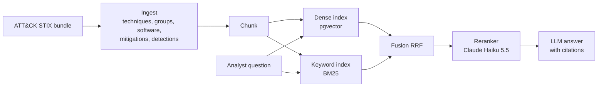

# ATT&CK Analyst Assistant

> Hybrid-search RAG over MITRE ATT&CK that answers SOC questions with cited sources.
> **Result:** _(filled in after evaluation: recall@10 dense vs hybrid, faithfulness)_

## Results

**Golden set:** 116 questions generated from ATT&CK's structure (49 English, 49 Arabic, 18 Arabic-with-ID), graded
relevance from the data, answer-leak checked ([how](docs/DECISIONS.md)). Full pipeline = mean of 3 runs (the LLM
reranker is not deterministic). From `python -m products.attack.eval_golden`; raw numbers in `eval/results/`.

| Config | hit@5 | recall@10 | MRR@10 | nDCG@10 | Latency (CPU) |
|---|---|---|---|---|---|
| Dense only (bge-m3 + pgvector) | 0.681 | 0.642 | 0.578 | 0.482 | 2.1 s |
| BM25 only | 0.741 | 0.756 | 0.609 | 0.595 | 7 ms |
| Hybrid (RRF) + exact-ID pinning | 0.905 | 0.848 | 0.763 | 0.686 | 2.1 s |
| + Claude Haiku 5.5 translation + rerank | **0.957** | **0.912** | **0.851** | **0.786** | 5.1 s |

Arabic questions over English documents score close to English ones (nDCG 0.749 vs 0.777). CI fails if committed
results drop below `eval/baseline.json`. How the set is built and what the eval found:
[docs/steps/05-golden-set-and-eval.md](docs/steps/05-golden-set-and-eval.md).
**Answers** (phase 3; fresh sample of 40 golden questions + 12 unanswerable; Claude Haiku 5.5 writes, Claude
Sonnet 5.5 judges; `python -m products.attack.eval_answers --seed 12`):

| Metric | Result |
|---|---|
| Answers with every claim cited | 100% |
| Unanswerable questions refused (fake IDs, off-topic, predictions) | 12/12 |
| Faithfulness (claims supported by their cited source) | 0.960 (English 0.986, Arabic 0.956) |
| Answer in the question's language | 100% |

How: numbered sources, a citation after every sentence or a fixed refusal, then code guards for language and
citations ([step 7](docs/steps/06-cited-answers.md)). Try it: `uvicorn products.attack.api:app --port 8000`.

_Demo video: (link)_

## Architecture



## Design decisions

See [docs/DECISIONS.md](docs/DECISIONS.md).

## What did not work

- **Dense retrieval alone cannot find ATT&CK IDs.** In the step 3 probe, all three embedding models missed bare-ID questions ("ما هي التقنية T1003.001؟") entirely. That is why keyword search is part of the design ([step 3](docs/steps/03-database-and-embeddings.md)).

- **The eval found a data gap no model could fix.** "How do I mitigate X?" scored nDCG 0.232: MITRE's
  technique-specific mitigation advice lives in relationship descriptions, which ingestion had dropped
  ([step 5-6](docs/steps/05-golden-set-and-eval.md)).

- **Prompt rules are not reliable on new questions.** Adding one sentence to the answer prompt dropped fully
  cited answers from 94.7% to 30%; a tuned prompt slipped from 97.5% to 89.7% on questions it hadn't seen. Rules
  that must always hold now run as code after the model ([step 7](docs/steps/06-cited-answers.md)).

_(more as the project goes)_

## Run it

```bash
make install    # once: .venv + package + dev tools
make ingest     # download ATT&CK (cached) + build data/processed/*.jsonl
make test
```

Layout: `core/` is the reusable RAG core (document schema now; retrieval, eval and guardrails next).
`products/attack/` is the ATT&CK-specific code.

## Project log

Progress and numbers per step: [docs/LOG.md](docs/LOG.md). Step-by-step explanations: [docs/steps/](docs/steps/).
