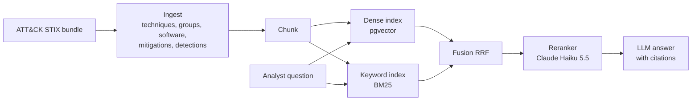

# ATT&CK Analyst Assistant

> Hybrid-search RAG over MITRE ATT&CK that answers SOC questions with cited sources.
> **Result:** _(filled in after evaluation: recall@10 dense vs hybrid, faithfulness)_

## Results

**Golden set:** 116 questions generated from ATT&CK's structure (49 English, 49 Arabic, 18 Arabic-with-ID), graded
relevance from the data, answer-leak checked ([how](docs/DECISIONS.md)). Full pipeline = mean of 3 runs (the LLM
reranker is not deterministic). From `python -m products.attack.eval_golden`; raw numbers in `eval/results/`.

| Config | hit@5 | recall@10 | MRR@10 | nDCG@10 | Latency (CPU) |
|---|---|---|---|---|---|
| Dense only (bge-m3 + pgvector) | 0.569 | 0.601 | 0.486 | 0.454 | 2.1 s |
| BM25 only | 0.655 | 0.746 | 0.556 | 0.581 | 7 ms |
| Hybrid (RRF) + exact-ID pinning | 0.802 | 0.838 | 0.678 | 0.660 | 2.1 s |
| + Claude Haiku 5.5 translation + rerank | **0.877** | **0.873** | **0.784** | **0.768** | 5.2 s |

Arabic questions score like English ones (nDCG 0.745 vs 0.733). CI fails if committed results drop below
`eval/baseline.json`. Weak spot: "how do I mitigate X?" questions (nDCG 0.232), being worked on.
Faithfulness of generated answers comes with phase 3.

_Demo video: (link)_

## Architecture



## Design decisions

See [docs/DECISIONS.md](docs/DECISIONS.md).

## What did not work

- **Dense retrieval alone cannot find ATT&CK IDs.** In the step 3 probe, all three embedding models missed bare-ID questions ("ما هي التقنية T1003.001؟") entirely. That is why keyword search is part of the design ([step 3](docs/steps/03-database-and-embeddings.md)).

_(more as the project goes)_

## Run it

```bash
make install    # once: .venv + package + dev tools
make ingest     # download ATT&CK (cached) + build data/processed/*.jsonl
make test
```

Layout: `core/` is the reusable RAG core (document schema now; retrieval, eval and guardrails next).
`products/attack/` is the ATT&CK-specific code.

## Project log

Progress and numbers per step: [docs/LOG.md](docs/LOG.md). Step-by-step explanations: [docs/steps/](docs/steps/).
