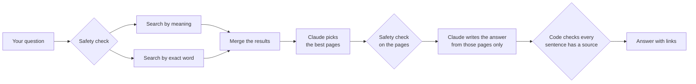

# ATT&CK Assistant

Ask how attackers work, in English or Arabic, and get an answer where every sentence links to its source. If the sources don't have the answer, it tells you instead of guessing.

The answers come from [MITRE ATT&CK](https://attack.mitre.org), the public guide security teams use to look up attack methods, hacking groups, their tools, and how to spot or stop them. It's built for SOC analysts, who need to check an answer before they act on it.

## What it does

| You ask | You get |
|---|---|
| "How do I detect Kerberoasting?" | The event IDs and logs to watch, with a link to the ATT&CK page behind each sentence |
| A question in Arabic | An answer in Arabic, from pages written in English |
| "What does T1070.001 mean?" | That exact entry, found by its ID |
| A made-up ID, or something off-topic | "ATT&CK doesn't answer this", not a guess |

## How well it works

Every number comes from a test in this repo, and the raw results are in [`eval/results/`](eval/results). These are test questions built from ATT&CK's own data. It hasn't been used by a real security team.

| What was tested | Result |
|---|---|
| Right page in the top 5 results, 116 questions | **95%** |
| The same with search by meaning alone | 68% |
| Answers where every sentence has a source | **100%** |
| Sentences backed by the source they link to | **85% fully, 15% partly, 0% not at all** |
| Answers where every sentence was fully backed | 60% |
| Replies in the language of the question | 100% |
| Refuses what it can't answer: fake IDs, off-topic, predictions | **12 of 12** |
| Attacks that got through, with protection on | **1 of 18** |
| Cost per question | **about $0.001** |

**The attack that still gets through:** false facts planted in a page, with no instructions in them. Filters can't catch that, because it reads like a normal page. Stopping it means checking where each page came from, which isn't built yet ([T-003](docs/tasks/open/T-003-provenance.md)).

**How much the protection adds is hard to say from 18 attacks.** With it off, 1 of 18 got through in the latest run and 4 of 18 in an earlier run with longer answers.

<details>
<summary>Exact scores, for engineers</summary>

Retrieval, 116 questions (49 English, 49 Arabic, 18 Arabic with an ID). The full setup is the mean of 3 runs, because the reranker isn't deterministic. Run it with `python -m products.attack.eval_golden`.

| Setup | hit@5 | recall@10 | MRR@10 | nDCG@10 | Time on CPU |
|---|---|---|---|---|---|
| Dense only (bge-m3 + pgvector) | 0.681 | 0.642 | 0.578 | 0.482 | 2.1 s |
| BM25 only | 0.741 | 0.756 | 0.609 | 0.595 | 7 ms |
| Hybrid (RRF) + exact-ID pinning | 0.905 | 0.848 | 0.763 | 0.686 | 2.1 s |
| + Claude Haiku 5.5 translation + rerank (top 15) | **0.951** | **0.877** | **0.856** | **0.766** | 2.2 s |

Answers, 40 questions plus 12 it can't answer, written by Claude Haiku 5.5 and judged by Claude Sonnet 5.5: faithfulness 0.923 (English 0.937, Arabic 0.923), fully faithful answers 60%, language match 100%, answered 40 of 40. Of 116 sentences the judge called 99 supported, 17 partly and 0 unsupported. The earlier, longer answers on the same sample scored 0.970 and 81.6%, with 8 of 136 sentences partly supported and 0 unsupported ([D53](docs/DECISIONS.md)). Run it with `python -m products.attack.eval_answers --seed 12`.

Attacks, 18 judged by canaries, not by a model. Run it with `python -m products.attack.redteam`.

| Attack type | Success without guards | Success with guards |
|---|---|---|
| Direct prompt injection (8) | 12.5% | **0%** |
| Instructions planted in documents (6) | 0% | 0% |
| False facts, no instructions (2) | 0% | 50% |
| Tool abuse across tenants (2) | 0% | 0% |
| **All (18)** | **5.6%** | **5.6%** |

Each attack counts for 5.6%, so one attack going either way moves these a lot. The run before answers were made plain scored 22.2% without guards and 5.6% with them (`eval/results/redteam_before_plain.json`).

The guards had 0 false alarms across all 3,581 passages, which include pages that describe prompt injection, and the 116 test questions. Findings are logged as ECS-style JSON for a SIEM.

Cost: $0.0010 per question on average, $0.0014 at p95, about $3 per 1,000 conversations of three questions.

CI fails if the saved results drop below [`eval/baseline.json`](eval/baseline.json).

</details>

## How it works



1. **It reads ATT&CK once.** 2,530 pages, split into 3,581 passages and saved in Postgres.
2. **It searches two ways at once.** One by meaning, one by exact word. Search by meaning can't find an ID like T1003.001, and search by word misses a question asked in other words. Together they find far more than either alone.
3. **Claude picks the best pages.** Arabic questions get translated first, because the pages are in English.
4. **Claude writes a short answer from those pages only,** in everyday words, with no internal codes unless you ask about a code. Then code, not the model, checks that every sentence has a real source and that the language is right. Anything that fails is removed.
5. **Each team's data stays apart.** The database enforces this itself with row-level security, so even a query with a mistake in it can't read another team's rows. Tools are limited per team too, and the model never gets to choose whose data it sees.

**What runs where:** the search model (bge-m3) runs on your computer through Ollama. Translating, picking the best pages and writing the answer use Claude over the internet, with your API key.

**Built with:** Python, FastAPI, Postgres with pgvector and row-level security, BM25, bge-m3 through Ollama, and Claude Haiku 5.5. `core/` is the part any set of documents could reuse, and `products/attack/` is what's specific to ATT&CK.

## What went wrong along the way

- **Search by meaning can't find IDs.** All three models tried missed plain questions asking in Arabic what T1003.001 is. That's why search by exact word is in there ([step 3](docs/steps/03-database-and-embeddings.md)).
- **The tests found missing data that no model could fix.** "How do I stop X?" scored far below everything else, because MITRE keeps that advice in the links between pages, and the import had thrown those away ([step 5](docs/steps/05-golden-set-and-eval.md)).
- **Rules in the prompt can't be trusted.** One extra sentence in the prompt dropped fully sourced answers from 94.7% to 30%. A carefully tuned prompt still slipped from 97.5% to 89.7% on new questions. Rules that must always hold now run as code after the model ([step 7](docs/steps/06-cited-answers.md)).
- **Simpler words cost some accuracy.** When answers were cut down to short, everyday words, sentences only partly backed by their source went from 8 of 136 to 17 of 116. None were unsupported, but shortening does lose detail ([D53](docs/DECISIONS.md)).
- **Saved answers hid the real score.** After caching was added, three test runs came back identical, because they were replaying the first run. Tests now start empty ([D38](docs/DECISIONS.md)).
- **A shell edit broke two safety checks with no error.** It turned `\b` into a backspace character, so two patterns silently stopped matching. A test now rejects control characters in the code ([step 9](docs/steps/08-security.md)).

## Run it

You need Python 3.11 or newer, [Ollama](https://ollama.com), and your own Claude API key. This repo doesn't include a key, so whoever runs it uses their own and pays for their own questions.

```bash
make install    # once: creates .venv and installs everything, including a local Postgres
make ingest     # downloads ATT&CK and prepares it
ollama pull bge-m3
```

Keep `ollama serve` running in another window, and activate `.venv`. Then build the search index and run the tests:

```bash
python -m products.attack.index
make test
```

Copy `.env.example` to `.env` and add your key. `LLM_BUDGET_USD` there is a hard spending limit. Then start the page and open http://localhost:8000:

```bash
uvicorn products.attack.api:app --port 8000
```

**If the first question fails** after the computer shut down without stopping the database, it's still recovering. Wait about 40 seconds and restart the app.

## More detail

- [docs/steps/](docs/steps/): each build step explained from the start
- [docs/DECISIONS.md](docs/DECISIONS.md): every choice, what was rejected and why
- [docs/LOG.md](docs/LOG.md): what was done, with the numbers

<details>
<summary>All commands</summary>

- `make install`: create `.venv` and install the package and pytest
- `make ingest`: download ATT&CK (cached in `data/raw/`) and build `data/processed/*.jsonl`
- `make test`: run pytest. Real-data tests skip until `make ingest` has run, and database tests use `DATABASE_URL` or pgserver
- `make db`: Postgres + pgvector in Docker (optional: without it `core/db.py` starts pgserver)
- `python -m products.attack.index`: split, embed and write the pgvector index (needs `ollama serve`)
- `python -m products.attack.retrieval_check [--stack haiku|local]`: score each search stage (about $0.11 per Haiku run)
- `python -m products.attack.embedding_probe [model ...]`: compare embedding models (needs `ollama serve`, about 7 minutes per model the first time)

</details>
