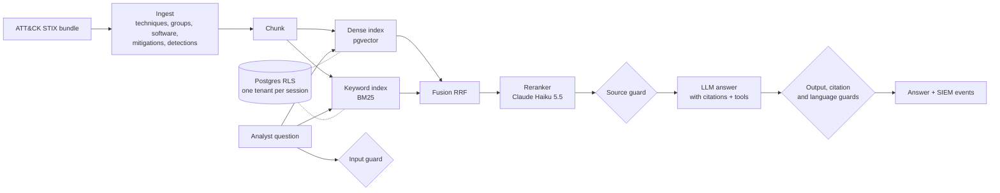

# ATT&CK Analyst Assistant

> Hybrid-search RAG over MITRE ATT&CK that answers SOC questions with cited sources.
> **Result:** hybrid search + Claude Haiku rerank lifts nDCG@10 from 0.48 (dense only) to 0.77; 100% of answers
> cite their sources (faithfulness 0.97); tenants isolated by Postgres row-level security; prompt-injection attack
> success 22% -> 6% with guards; ~$0.001 per question.

## Results

**Golden set:** 116 questions generated from ATT&CK's structure (49 English, 49 Arabic, 18 Arabic-with-ID), graded
relevance from the data, answer-leak checked ([how](docs/DECISIONS.md)). Full pipeline = mean of 3 runs (the LLM
reranker is not deterministic). From `python -m products.attack.eval_golden`; raw numbers in `eval/results/`.

| Config | hit@5 | recall@10 | MRR@10 | nDCG@10 | Latency (CPU) |
|---|---|---|---|---|---|
| Dense only (bge-m3 + pgvector) | 0.681 | 0.642 | 0.578 | 0.482 | 2.1 s |
| BM25 only | 0.741 | 0.756 | 0.609 | 0.595 | 7 ms |
| Hybrid (RRF) + exact-ID pinning | 0.905 | 0.848 | 0.763 | 0.686 | 2.1 s |
| + Claude Haiku 5.5 translation + rerank (top 15) | **0.951** | **0.877** | **0.856** | **0.766** | 2.2 s |

Arabic questions over English documents score close to English ones (nDCG 0.739 vs 0.751). Reranking the
top 30 instead of the top 15 scored recall@10 0.912 at 3.8x the rerank cost (D30); 3-run spread of the full
pipeline: hit@5 0.948-0.957, nDCG 0.761-0.770. CI fails if committed
results drop below `eval/baseline.json`. How the set is built and what the eval found:
[docs/steps/05-golden-set-and-eval.md](docs/steps/05-golden-set-and-eval.md).
**Answers** (phase 3; fresh sample of 40 golden questions + 12 unanswerable; Claude Haiku 5.5 writes, Claude
Sonnet 5.5 judges; `python -m products.attack.eval_answers --seed 12`):

| Metric | Result |
|---|---|
| Answers with every claim cited | 100% |
| Unanswerable questions refused (fake IDs, off-topic, predictions) | 12/12 |
| Faithfulness (claims supported by their cited source) | 0.960 (English 0.986, Arabic 0.956) |
| Answer in the question's language | 100% |

How: numbered sources, a citation after every sentence or a fixed refusal, then code guards for language and
citations ([step 7](docs/steps/06-cited-answers.md)). Try it: `uvicorn products.attack.api:app --port 8000`.

**Tenant isolation** (phase 4): the serving path logs in as an unprivileged role and Postgres row-level security
limits every query to one tenant, even one without a WHERE clause. Tested against a real Postgres, including the
case where approximate vector search starves a small tenant sharing a table with a big one (fixed with exact search
below 20k chunks). Tools get strict schemas, a per-tenant allowlist, and the tenant is injected by code, never by
the model ([step 8](docs/steps/07-tenant-isolation-and-tools.md)).

**Security** (phase 5; `python -m products.attack.redteam`, 18 attacks judged by canaries, not by a model):

| Attack class | ASR without guards | ASR with guards |
|---|---|---|
| Direct prompt injection (8) | 37.5% | **0%** |
| Instructions planted in documents (6) | 0% | 0% |
| Semantic poisoning: false facts, no instructions (2) | 50% | 50% |
| Tool abuse across tenants (2) | 0% | 0% |
| **All (18)** | **22.2%** | **5.6%** |

Guards: 0 false positives over the whole corpus (which *describes* prompt injection) and the golden questions;
findings are logged as ECS-style JSON for a SIEM. The residual risk, semantic poisoning, needs source provenance,
not filters ([step 9](docs/steps/08-security.md)).

**Cost** (phase 6): $0.0010 per question on average (p95 $0.0014), ~$3 per 1,000 three-question conversations.
The rerank was 81% of the spend; trimming its input made it 3.8x cheaper. Caches keyed by an index fingerprint and a
router that skips translation and rerank for bare-ID questions ([step 10](docs/steps/09-cost.md)).

_Demo video: (link)_

## Architecture



## Design decisions

See [docs/DECISIONS.md](docs/DECISIONS.md).

## What did not work

- **Dense retrieval alone cannot find ATT&CK IDs.** In the step 3 probe, all three embedding models missed bare-ID questions ("ما هي التقنية T1003.001؟") entirely. That is why keyword search is part of the design ([step 3](docs/steps/03-database-and-embeddings.md)).

- **The eval found a data gap no model could fix.** "How do I mitigate X?" scored nDCG 0.232: MITRE's
  technique-specific mitigation advice lives in relationship descriptions, which ingestion had dropped
  ([step 5-6](docs/steps/05-golden-set-and-eval.md)).

- **Prompt rules are not reliable on new questions.** Adding one sentence to the answer prompt dropped fully
  cited answers from 94.7% to 30%; a tuned prompt slipped from 97.5% to 89.7% on questions it hadn't seen. Rules
  that must always hold now run as code after the model ([step 7](docs/steps/06-cited-answers.md)).

- **Cached evaluations lie.** After adding caches, three golden-set runs came back identical: the cache replayed
  run 1 and hid the reranker's variance. Evaluations now start cold ([D38](docs/DECISIONS.md)).

- **A shell edit turned `\b` into a backspace character** and two guard patterns silently stopped matching; a
  test now rejects control characters in the source tree ([step 9](docs/steps/08-security.md)).

## Run it

```bash
make install    # once: .venv + package + dev tools
make ingest     # download ATT&CK (cached) + build data/processed/*.jsonl
make test
```

Layout: `core/` is the reusable RAG core (schema, search, rerank, answers, guardrails, tools, caches, tenant isolation).
`products/attack/` is the ATT&CK-specific code.

## Project log

Progress and numbers per step: [docs/LOG.md](docs/LOG.md). Step-by-step explanations: [docs/steps/](docs/steps/).
