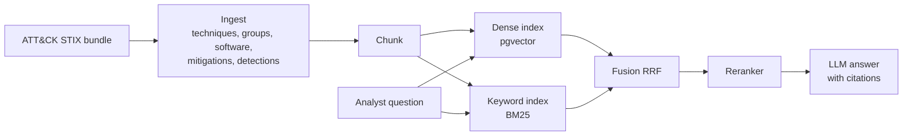

# ATT&CK Analyst Assistant

> Hybrid-search RAG over MITRE ATT&CK that answers SOC questions with cited sources.
> **Result:** _(filled in after evaluation: recall@10 dense vs hybrid, faithfulness)_

## Results

| Config | recall@10 | MRR | nDCG@10 | Faithfulness | p95 latency |
|---|---|---|---|---|---|
| Dense only | – | – | – | – | – |
| BM25 only | – | – | – | – | – |
| Hybrid (RRF) | – | – | – | – | – |
| Hybrid + reranker | – | – | – | – | – |

_Demo video: (link)_

## Architecture



## Design decisions

See [docs/DECISIONS.md](docs/DECISIONS.md).

## What did not work

- **Dense retrieval alone cannot find ATT&CK IDs.** In the step 3 probe, all three embedding models missed bare-ID questions ("ما هي التقنية T1003.001؟") entirely. That is why keyword search is part of the design ([step 3](docs/steps/03-database-and-embeddings.md)).

_(more as the project goes)_

## Run it

```bash
make install    # once: .venv + package + dev tools
make ingest     # download ATT&CK (cached) + build data/processed/*.jsonl
make test
```

Layout: `core/` is the reusable RAG core (document schema now; retrieval, eval and guardrails next).
`products/attack/` is the ATT&CK-specific code.

## Project log

Progress and numbers per step: [docs/LOG.md](docs/LOG.md). Step-by-step explanations: [docs/steps/](docs/steps/).
