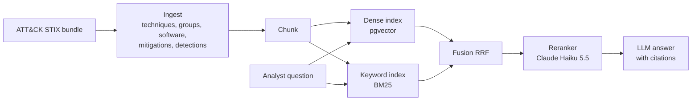

# ATT&CK Analyst Assistant

> Hybrid-search RAG over MITRE ATT&CK that answers SOC questions with cited sources.
> **Result:** _(filled in after evaluation: recall@10 dense vs hybrid, faithfulness)_

## Results

Retrieval so far (phase 1). 32 probe questions (12 English, the same 12 in Arabic, 8 Arabic with English IDs);
hit@5 = a correct document in the top 5, MRR@10 = 1/rank of the first correct one. From
`python -m products.attack.retrieval_check`; raw numbers in `eval/results/`.

| Config | hit@5 | MRR@10 | Latency per question (CPU) |
|---|---|---|---|
| Dense only (bge-m3 + pgvector) | 0.781 | 0.698 | ~2.1 s |
| BM25 only | 0.469 | 0.375 | 5 ms |
| Hybrid (RRF) | 0.875 | 0.768 | ~2.1 s |
| + query translation (Claude Haiku 5.5) | 1.0 | 0.768 | ~3.3 s |
| + exact-ID pinning | 1.0 | 0.784 | ~3.3 s |
| + reranker (Claude Haiku 5.5, listwise) | **1.0** | **0.896** | ~5.1 s |

Phase 1 gate (20 separate spot-check questions, correct doc in top 5): **20/20**.
Recall@10, nDCG and faithfulness on a 100+ question golden set come in phase 2.

_Demo video: (link)_

## Architecture



## Design decisions

See [docs/DECISIONS.md](docs/DECISIONS.md).

## What did not work

- **Dense retrieval alone cannot find ATT&CK IDs.** In the step 3 probe, all three embedding models missed bare-ID questions ("ما هي التقنية T1003.001؟") entirely. That is why keyword search is part of the design ([step 3](docs/steps/03-database-and-embeddings.md)).

_(more as the project goes)_

## Run it

```bash
make install    # once: .venv + package + dev tools
make ingest     # download ATT&CK (cached) + build data/processed/*.jsonl
make test
```

Layout: `core/` is the reusable RAG core (document schema now; retrieval, eval and guardrails next).
`products/attack/` is the ATT&CK-specific code.

## Project log

Progress and numbers per step: [docs/LOG.md](docs/LOG.md). Step-by-step explanations: [docs/steps/](docs/steps/).
