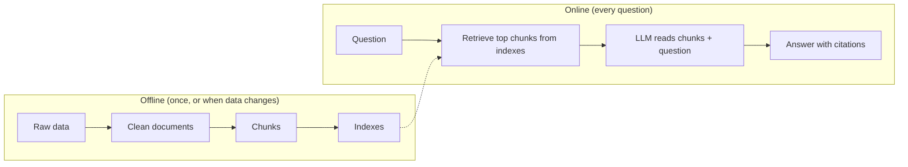

# Step 1: Ingestion, explained

## What RAG is, in one picture



An LLM only knows what it was trained on and what you put in its prompt. RAG (retrieval-augmented generation) means: before asking the model, search your own data for the relevant pieces and paste them into the prompt. The model then answers from those pieces and cites them.

**This step is the first box: raw data to clean documents.** Every later step depends on it. Bad documents here means bad retrieval, and no model can fix bad retrieval.

## What the raw data looks like

MITRE publishes ATT&CK as one STIX 2.1 JSON file (~50 MB). STIX is a standard format for threat intel. Everything is an "object" with a `type`:

| STIX type | What it is | Example ID |
|---|---|---|
| `attack-pattern` | Technique / sub-technique | T1059.001 PowerShell |
| `intrusion-set` | Threat group | G0016 APT29 |
| `malware`, `tool` | Software | S0154 Cobalt Strike |
| `course-of-action` | Mitigation | M1042 Disable or Remove Feature or Program |
| `campaign` | A specific operation | C0024 SolarWinds Compromise |
| `x-mitre-detection-strategy` | How to detect a technique | DET0455 |
| `x-mitre-analytic` | One concrete detection rule inside a strategy | AN1252 |
| `relationship` | An edge: A uses / mitigates / detects B | G0016 uses T1059.001 |

## What the script does

1. **Download once, cache.** The file goes to `data/raw/`. Re-runs read the local copy, so you're not hitting GitHub every time and results are reproducible.
2. **Filter.** Keep only active objects. Revoked/deprecated = outdated knowledge (decision D2).
3. **Flatten each object to text.** A header (ID, name, type, tactics, platforms) plus the cleaned description. The header matters: it puts "T1059.001" and "PowerShell" literally in the text so keyword search can match them.
4. **Clean.** ATT&CK descriptions contain `(Citation: ...)` markers and internal markdown links. They're noise for search, so they're stripped.
5. **Build detection docs.** Current ATT&CK keeps detection logic in separate objects. The script joins strategy → analytics → log sources → techniques into one readable document (decision D3).
6. **Save relationships separately.** Not used yet. Kept for the graph-RAG stretch goal and for building multi-hop eval questions ("which groups use a technique that M1042 mitigates?").

## Why each output field exists

| Field | Used later for |
|---|---|
| `doc_id` | Citations, eval golden set, joining chunks back to docs. Must never change. |
| `type`, `tactics`, `platforms` | Metadata filters ("only Windows detections"). |
| `url` | Clickable citation in the answer. |
| `content_hash` | On re-ingest, only re-embed documents whose text changed. Saves money and time. |
| `text` | What gets chunked and embedded. |

## Things to be able to explain in an interview

- **Why not scrape the website?** Structured source = stable IDs, relationships, version history. Scraping breaks when the HTML changes.
- **What surprised you?** The detection field disappeared between ATT&CK versions. You found it by inspecting the data, not by trusting old tutorials. That's a real "what went wrong" story.
- **Why stable IDs?** The eval set references `doc_id`. If IDs shift, every past result becomes incomparable.

## Run it yourself

```bash
python -m src.ingest.attack
```

Then open `data/processed/attack_docs.jsonl` and read 10 random lines. Always look at your data before indexing it.
