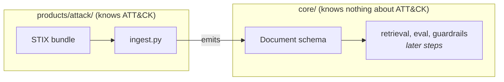

# Step 2: Shared core and document schema, explained

## What changed, in one picture



Before this step the ingest script wrote whatever dict shape was handy. Now there is one **contract**, `core.schema.Document`, and the ATT&CK code is an *adapter* that converts STIX into it. Everything downstream (chunking, indexing, eval, answering) is written against `Document`, never against STIX.

## Why split into `core/` and `products/`?

- **Reuse.** Retrieval, evaluation and guardrails are the same problem for any corpus. Build and measure them once.
- **Honest boundaries.** If core code ever needed to say "technique", it would be ATT&CK code in disguise. `tests/test_core_vocabulary.py` fails the build if corpus words leak into `core/`.
- **Testability.** The adapter is now a pure function (`build_all(objects) -> (docs, rels)`), so it can be tested on a 9-object fake bundle in milliseconds, without the 50 MB download.

## The schema

| Field | Why it exists |
|---|---|
| `doc_id` | Stable key for citations and the eval golden set. Never changes on re-ingest (D4). |
| `tenant_id` | Who owns the document. Every query will be filtered by it; isolation is tested in phase 4. Added now because adding it later means migrating every index. |
| `source` | Which dataset it came from. |
| `type` | Document kind, chosen by the adapter (`technique`, `detection`, ...). Used for filters. |
| `title` | Human-readable name for citations. |
| `text` | What gets chunked and embedded. |
| `url` | Clickable citation. |
| `metadata` | Everything corpus-specific (tactics, platforms, stix_id, detects ...). Free-form dict. |
| `content_hash` | SHA-256 of `text` (16 hex). Re-embed only what changed. |

Three rules are enforced by the model itself (pydantic), not by convention:

1. **Unknown fields are rejected** (`extra="forbid"`). If someone adds `platforms=` at the top level, it fails loudly instead of silently being ignored by downstream code. It belongs in `metadata`.
2. **`content_hash` must match `text`.** `Document.build(...)` computes it for you, and a hand-written wrong hash is rejected. A stale hash would mean a changed document never gets re-embedded, a silent bug.
3. **Documents are immutable** (`frozen=True`). Pipeline stages produce new values instead of editing shared ones.

## Tests added

| Test file | What it proves |
|---|---|
| `test_schema.py` | Blank or missing fields, wrong hash, unknown fields and mutation are all rejected; JSON round-trips. |
| `test_attack_ingest.py` (fixture part) | On a tiny fake bundle: revoked and ID-less objects are dropped, citation markers stripped, detection docs join their analytics, relationships to dropped objects are skipped. |
| `test_attack_ingest.py` (real part) | Every one of the 2,530 real docs validates, doc_ids are unique, every relationship points at a real doc. Skipped if `make ingest` hasn't run. |
| `test_core_vocabulary.py` | `core/` contains no corpus words. |

## Things to be able to explain in an interview

- **Why a schema at all?** It's the contract between the data team and the retrieval team. A validator at the boundary turns "weird results in week 6" into "a failing test on day 1".
- **Why `tenant_id` in a single-tenant project?** Multi-tenancy is very expensive to retrofit: every index, cache key and query would change. One field now costs nothing.
- **Why `metadata` instead of more columns?** Each corpus has different fields. A fixed core plus a free-form bag keeps the core stable. The cost: metadata isn't type-checked, so filters on it need their own tests.
- **What did the refactor prove?** Output counts are identical to step 1 (2,530 docs, 21,660 relationships, same lengths), so the move changed the structure, not the data.

## Run it yourself

```bash
make install    # once: .venv + package + pytest
make ingest
make test
```

No `make` on Windows? Run the same commands directly: `.venv\Scripts\python -m products.attack.ingest` and `.venv\Scripts\python -m pytest`.
