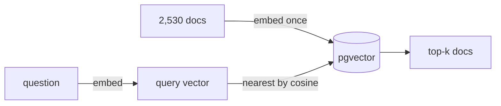

# Step 3: Database and embedding model, explained

Step 3 has two halves: **(a)** a place to keep vectors (Postgres + pgvector), and **(b)** choosing the
model that turns text into vectors, by measuring three candidates instead of trusting their model cards.

## What an embedding is

An embedding model turns a piece of text into a list of numbers (a vector, here 768 or 1024 of them) so that
texts with similar *meaning* end up close together. "Dump credentials from LSASS" and "steal passwords from
Windows memory" share almost no words but land near each other. Dense retrieval = embed the question, return
the documents whose vectors are closest (cosine similarity).



## 3a. Postgres + pgvector

- **Why Postgres and not a vector database?** One system holds the documents, the vectors, keyword search
  (full-text) and later the tenant rules (row-level security). Fewer moving parts, real SQL, and filters
  (`WHERE tenant_id = ... AND type = 'detection'`) in the same query as the vector search.
- **`docker-compose.yml`** runs `pgvector/pgvector:0.8.7-pg16`. That is what CI uses (GitHub Actions service
  container) and what every machine with Docker uses.
- **No Docker here yet**, so `core/db.py` falls back to `pgserver`, a pip package that ships Postgres 16 +
  pgvector 0.6.2 and runs without admin rights (decision D9). Same SQL either way.
- **HNSW** is the index type that makes nearest-neighbour search fast (it searches a graph instead of
  comparing against every vector). `tests/test_db.py` builds one and checks the right row comes back first.

## Side finding: revoked IDs (ATT&CK v20)

While building the probe questions, T1070.001 "Clear Windows Event Logs" was missing. The downloaded bundle is
ATT&CK v20, which *revoked* it in favour of T1685.005. Analysts and old reports keep using old IDs for years,
so the ingest now follows `revoked-by` links (157 IDs) and writes `Previously: T1070.001` into the replacement's
header (decision D8). A data surprise found by looking at the data, again.

## 3b. The embedding probe

**Candidates** (all multilingual, all free, all run locally through Ollama):

| Model | Size | Dimensions | Context |
|---|---|---|---|
| bge-m3 | 568M params | 1024 | 8,192 tokens |
| snowflake-arctic-embed2 | 568M params | 1024 | 8,192 tokens |
| embeddinggemma | 308M params | 768 | 2,048 tokens |

**Questions** (`eval/embedding_probe.jsonl`, 32 total), each with the doc ID(s) that should come back:
- 12 English, 12 Arabic (the *same* 12 questions translated, so the two can be compared), 8 mixed
  (Arabic sentence with an English ID or tool name, which is how many analysts actually type).

**Metrics:**
- **hit@1 / hit@5**: share of questions where a right doc is ranked 1st / in the top 5.
- **MRR@10**: average of 1/rank of the first right doc (1.0 = always first, 0.5 = always second, 0 = not in top 10).
- **EN-AR cosine**: how close the English and Arabic versions of the same question are. High = the model
  understands they mean the same thing.

**Results** (`python -m products.attack.embedding_probe`, raw output in `eval/results/embedding_probe.json`):

| Model | English hit@1 / hit@5 / MRR | Arabic hit@1 / hit@5 / MRR | Mixed hit@1 / hit@5 / MRR | All 32: hit@1 / hit@5 / MRR | EN-AR cos | docs/s (CPU) |
|---|---|---|---|---|---|---|
| bge-m3 | 0.583 / 0.833 / 0.720 | **0.667 / 0.750 / 0.688** | 0.500 / 0.750 / 0.625 | **0.594** / 0.781 / 0.684 | **0.826** | 6.3 |
| snowflake-arctic-embed2 | **0.667 / 1.000 / 0.819** | 0.333 / 0.667 / 0.465 | 0.625 / 0.750 / 0.656 | 0.531 / 0.812 / 0.646 | 0.695 | 6.3 |
| embeddinggemma | 0.583 / 1.000 / 0.778 | 0.417 / 0.750 / 0.604 | 0.625 / 0.750 / 0.688 | 0.531 / **0.844 / 0.690** | 0.728 | 6.7 |

Query latency with the model already loaded is about 150 ms per question for all three (CPU, via Ollama).
The first query after loading a model is slower (about 0.5 s), so measure warm.

## What the numbers say

1. **Dense search cannot find bare IDs.** "ما هي التقنية T1003.001؟" and "ما معنى T1070.001؟" missed the top 10
   for *every* model. An embedding captures meaning, and "T1003.001" has no meaning to it, just characters.
   This is the strongest argument for hybrid search: keyword search (BM25) handles IDs, dense handles meaning.
2. **Arabic separates the models.** On English all three are close. On Arabic, bge-m3 leads (MRR 0.688 vs
   0.604 and 0.465) and keeps English and Arabic versions of a question closest (0.826).
3. **Overall they are close.** Across all 32 questions: embeddinggemma 0.69, bge-m3 0.68, arctic 0.65. With 12
   questions per language, one question moves a score by 0.083. These are signals, not proof.
4. **Hard cases worth remembering:** Arabic "ransomware" (برنامج فدية) failed for all three (the ATT&CK doc is
   titled "Data Encrypted for Impact"); "scheduled task" often returned the parent technique T1053 first.

**Choice: bge-m3** (decision D10): best on the hardest part (Arabic), best cross-language agreement, long
context. embeddinggemma is the runner-up (smaller, 768 dims, strong on English and mixed) and gets re-tested on
the 100-question golden set in phase 2.

## Things to be able to explain in an interview

- **Why measure instead of reading leaderboards?** Leaderboards (MTEB) average many tasks and languages. Your
  data (security jargon, IDs, Arabic questions about English docs) is not their data. 32 questions and 20
  minutes of CPU time answered the actual question.
- **What does "query prefix" mean?** Some models were trained with `query: ` in front of questions. Leaving it
  out silently lowers accuracy, so the prefix lives in one place (`core/embeddings.py`) next to the model name.
- **Why is the probe not the eval?** 32 questions are enough to rule a model out, not to publish a score. The
  phase 2 golden set (100+ questions, CI-gated) is where numbers for the README come from.
- **Biggest lesson:** dense retrieval fails on exact identifiers, so production RAG over technical data needs
  keyword search alongside it.

## Caveats

- The Arabic questions were written for this probe and should be reviewed by a native speaker before they
  join the golden set.
- CPU only: embedding the corpus takes about 7 minutes per model on this machine. Chunking (step 4) will
  increase the number of vectors.

## Run it yourself

```bash
ollama serve                                       # in another terminal
ollama pull bge-m3 && ollama pull snowflake-arctic-embed2 && ollama pull embeddinggemma
python -m products.attack.embedding_probe          # all three; or name one: ... embedding_probe bge-m3
```
