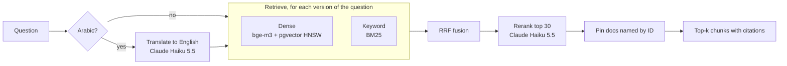

# Step 4: Hybrid search, explained

This step turns 2,530 documents into a search system and measures every stage of it separately.



## 1. Chunking

Embedding models work best on passages of a few hundred words, and a citation should point at the passage that
answers the question, not a whole page. Documents up to 1,500 characters stay whole (most of them); longer ones
are split on paragraph boundaries. **Every chunk repeats the document's header** (`T1055: Process Injection`,
type, tactics...), so a chunk from the middle of a long detection strategy still says what it is about.

## 2. Two retrievers

| | Dense (bge-m3 + pgvector) | Keyword (BM25) |
|---|---|---|
| Matches | meaning ("steal passwords" ~ "credential dumping") | exact tokens ("T1003.001") |
| Fails on | bare IDs, rare names | synonyms, other languages |
| Cost | one embedding per question, an HNSW lookup | in-memory, microseconds |

The tokenizer matters as much as BM25 itself: IDs stay whole (`t1003.001`, plus the base `t1003`), and Arabic is
normalised (أ/إ/آ -> ا, ة -> ه, ى -> ي, diacritics and tatweel removed, و/ب/ال prefixes stripped).

## 3. Reciprocal Rank Fusion (RRF)

`score(doc) = Σ 1 / (60 + rank)` over the rankings. It uses ranks only, so a cosine similarity and a BM25 score
(different scales) combine without calibration, and a document ranked well by *both* retrievers rises to the top.

## 4. Query translation

The documents are English. An Arabic question shares no words with them, so keyword search is blind to it (it
scored 0.0 on Arabic questions). Claude Haiku 5.5 translates the question (a local qwen2.5:3b also works, worse);
both versions are searched by both retrievers, so four rankings are fused.

## 5. Exact-ID pinning

If the question contains a document ID (or a revoked ID that now points to a newer document), that document goes
first. Without it, "What is T1486?" returned detection strategies that *list* T1486 above T1486 itself.

## 6. Reranking

Dense search compares two vectors computed separately. A reranker reads the question and the passages together
and judges which ones actually answer it: much more accurate, much slower, so it only re-orders the top 30. Two
kinds were measured: local cross-encoders (score each pair) and Claude Haiku 5.5 as a *listwise* reranker (sees
all 30 at once and returns them in order). Haiku won clearly (table below) and reads the Arabic question directly.

## 7. Relationships as text

ATT&CK keeps "APT29 uses Mimikatz" in separate relationship objects. Search only sees document text, so a question
like "which software does APT29 use?" had **no document containing the answer**. The ingest now writes those lists
into the documents, the way attack.mitre.org pages show them ("Software used: Mimikatz (S0002); ...").

## Results (`python -m products.attack.retrieval_check --stack haiku`)

Each row adds one stage to the row above (an *ablation*). hit@1 / hit@5 / MRR@10.

**Spot checks** (20 new questions; the phase 1 gate):

| Stage | Arabic (6) | English (8) | Mixed / IDs (6) | All (20) |
|---|---|---|---|---|
| dense only | 0.333 / 0.833 / 0.542 | 0.625 / 1.0 / 0.812 | 0.333 / 0.667 / 0.450 | 0.45 / 0.85 / 0.622 |
| keyword only | 0.0 / 0.0 / 0.0 | 0.25 / 1.0 / 0.556 | 0.5 / 0.5 / 0.5 | 0.25 / 0.55 / 0.372 |
| hybrid (RRF) | 0.333 / 0.833 / 0.542 | 0.625 / 1.0 / 0.812 | 0.5 / 0.667 / 0.556 | 0.5 / 0.85 / 0.654 |
| + translation | 0.333 / 0.833 / 0.607 | 0.625 / 1.0 / 0.812 | 0.5 / 0.667 / 0.583 | 0.5 / 0.85 / 0.682 |
| + ID pinning | 0.333 / 0.833 / 0.607 | 0.625 / 1.0 / 0.812 | **1.0 / 1.0 / 1.0** | 0.65 / 0.95 / 0.807 |
| + Haiku rerank | 0.5 / **1.0** / 0.722 | 0.875 / 1.0 / 0.938 | 1.0 / 1.0 / 1.0 | **0.80 / 1.0 / 0.892** |

**Probe** (the 32 step 3 questions): dense 0.625 / 0.781 / 0.698 -> full pipeline **0.812 / 1.0 / 0.896**.

**Phase 1 gate: 20/20 spot checks have a correct document in the top 5. PASS** (also 20/20 with strict labels).

### Local models vs Claude Haiku 5.5 (same pipeline, same questions, before section 7)

| | Local: qwen2.5:3b + bge-reranker-v2-m3 | Claude Haiku 5.5 |
|---|---|---|
| Probe hit@1 / MRR | 0.656 / 0.785 | **0.906 / 0.932** |
| Rerank time per question | 42 s (CPU) | ~1.7 s (API) |
| Cost per question | $0 | ~$0.001 (800-char excerpts; ~$0.002 with full chunks) |

Search itself (embeddings, pgvector, BM25) stays local; Claude does the language work. The Anthropic API has no
embeddings endpoint, so the embedding model (bge-m3) is open source either way.

## What went wrong (and what it taught)

1. **Evaluating while indexing.** The first run happened while the index was being rewritten; pgvector's HNSW
   scan picked invisible rows as candidates and dropped them after, so dense search lost results (D13). The same
   mechanism threatens multi-tenant search: filters run after the vector scan.
2. **A cache that trusted a row count.** Re-using embedding-probe vectors checked only "same number of documents".
   After the relationship text changed 1,827 documents, old vectors were filed under new text. A log line
   ("Seeded 1827 vectors") gave it away. Now the cache file must carry a hash of the exact corpus; a test covers it.
3. **Labels that were too strict.** "Which software does Lazarus use?" listed only the group page as correct. The
   reranker returned three Lazarus malware pages, each one correct. Relevance for relationship questions now comes
   from ATT&CK's own links (D18), and the strict score is reported next to it.
4. **LLM rerankers are not deterministic.** Two identical runs: hit@1 0.75 vs 0.65. Single-run hit@1 differences
   of that size are noise (D19); hit@5 was stable.

## Things to be able to explain in an interview

- **Why hybrid?** Dense finds meaning, BM25 finds exact IDs; measured, neither alone passes (dense misses bare IDs,
  BM25 is blind to Arabic). RRF combines them without tuning score scales.
- **Why a reranker?** Retrieval is tuned for recall (get the answer into the top 30), the reranker for precision
  (put it first). Here it moved hit@1 from 0.65 to 0.80 on spot checks.
- **Why translate the query instead of the documents?** One short LLM call per question vs translating and
  re-indexing 2,530 documents in every language you support.
- **Cost per question?** ~$0.002 (rerank, ~20k input tokens with full 1,500-char chunks) + ~$0.00001 (translation) with Claude Haiku 5.5; everything else local.
- **How do you know it isn't overfitted to 20 questions?** You don't, yet: that is what the phase 2 golden set
  (100+ questions, graded relevance, several runs) is for.

## Run it yourself

```bash
ollama serve                                         # embeddings (bge-m3)
python -m products.attack.index                      # chunk + embed + write pgvector (cached after the first run)
python -m products.attack.retrieval_check            # needs ANTHROPIC_API_KEY in .env; ~$0.11 per run (52 questions)
python -m products.attack.retrieval_check --stack local   # free, offline, slow (CPU rerank)
```
