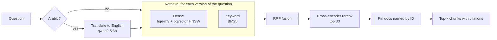

# Step 4: Hybrid search, explained

This step turns 2,530 documents into a search system and measures every stage of it separately.

## 1. Chunking

Embedding models work best on passages of a few hundred words, and a citation should point at the passage that
answers the question, not a whole page. Documents up to 1,500 characters stay whole (most of them); longer ones
are split on paragraph boundaries. **Every chunk repeats the document's header** (`T1055: Process Injection`,
type, tactics...), so a chunk from the middle of a long detection strategy still says what it is about.

## 2. Two retrievers

| | Dense (bge-m3 + pgvector) | Keyword (BM25) |
|---|---|---|
| Matches | meaning ("steal passwords" ~ "credential dumping") | exact tokens ("T1003.001") |
| Fails on | bare IDs, rare names | synonyms, other languages |
| Cost | one embedding per question, an HNSW lookup | in-memory, microseconds |

The tokenizer matters as much as BM25 itself: IDs stay whole (`t1003.001`, plus the base `t1003`), and Arabic is
normalised (أ/إ/آ -> ا, ة -> ه, ى -> ي, diacritics and tatweel removed, و/ب/ال prefixes stripped).

## 3. Reciprocal Rank Fusion (RRF)

`score(doc) = Σ 1 / (60 + rank)` over the rankings. It uses ranks only, so a cosine similarity and a BM25 score
(different scales) combine without calibration, and a document ranked well by *both* retrievers rises to the top.

## 4. Query translation

The documents are English. An Arabic question shares no words with them, so keyword search is blind to it (it
scored 0.0 on Arabic questions). A small local LLM translates the question; both versions are searched by both
retrievers, so four rankings are fused.

## 5. Exact-ID pinning

If the question contains a document ID (or a revoked ID that now points to a newer document), that document goes
first. Without it, "What is T1486?" returned detection strategies that *list* T1486 above T1486 itself.

## 6. Cross-encoder reranking

Dense search compares two vectors computed separately. A cross-encoder reads question and passage together and
scores how well the passage answers the question: much more accurate, much slower. So it only re-orders the top
30 candidates. Multilingual, so it scores an Arabic question against English text directly (and the translation
too; the better score counts).

RESULTS_PLACEHOLDER
