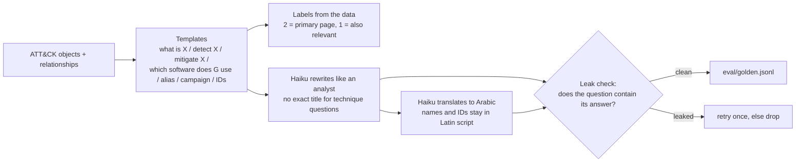

# Steps 5-6: Golden set, evaluation, and a fix it found, explained

## Why a golden set

Phase 1 was judged on 52 hand-written questions, and several of their labels had to be corrected along the way.
A trustworthy evaluation needs more questions and **labels that come from the data, not from the person who
built the system**. Then every later change (a new model, a prompt, a chunk size) gets a number, and CI can refuse
changes that make it worse.

## How the 116 questions are made (`products/attack/golden.py`)



- 49 English, 49 Arabic (same questions), 18 Arabic-with-ID ("ما هي التقنية T1059؟", revoked IDs, bare IDs).
- **The leak check matters.** Haiku wrote things like "...attribution Mustang Panda G0129": the question
  contained its own answer. A golden set like that inflates every score. Fix: Haiku only sees MITRE's description
  (no relationship lists), is told not to add names or IDs, and a whole-word check on every rewrite *and* every
  translation retries or drops leaky ones. CI re-checks it on every commit.
- Deterministic: fixed seed, Haiku outputs cached by prompt hash. Generating the whole set cost $0.0058.

## Metrics (`core/metrics.py`)

| Metric | Question it answers |
|---|---|
| hit@5 | Is a primary answer in the top 5? (what a reader of the first screen sees) |
| recall@10 | What share of the primary answers are in the top 10? |
| MRR@10 | How high is the first primary answer? (1 = first, 0.5 = second) |
| nDCG@10 | Are the better pages higher? Uses the grades, 1.0 = ideal order |

The LLM reranker is not deterministic, so the full pipeline is run **3 times**: mean and min-max are reported.

## Results (`python -m products.attack.eval_golden`)

| Config | hit@5 | recall@10 | MRR@10 | nDCG@10 | Latency (CPU) |
|---|---|---|---|---|---|
| Dense only | 0.681 | 0.642 | 0.578 | 0.482 | 2.1 s |
| BM25 only | 0.741 | 0.756 | 0.609 | 0.595 | 7 ms |
| Hybrid + ID pinning | 0.905 | 0.848 | 0.763 | 0.686 | 2.1 s |
| **+ Haiku translation + rerank + link expansion** | **0.957** | **0.912** | **0.851** | **0.786** | 5.1 s |

Arabic 0.749 / 0.918 and English 0.777 / 0.980 (nDCG / hit@5): Arabic questions over English documents now work
almost as well as English ones.

## What the eval found: "how do I mitigate X?"

The first baseline showed one template far below the rest: mitigate questions at nDCG 0.232. Tracing it:

1. **The answer was not in any document.** MITRE's technique-specific mitigation advice lives in the
   *description of each `mitigates` relationship* (all 1,477 have one). Ingestion had dropped it. Now every
   technique page lists each mitigation with that advice (D22).
2. **The answer pages share no words with the question.** "How do I stop attackers tampering with Linux logs?"
   leads to the technique; its mitigation pages are generic. One-hop link expansion lets the reranker see the
   linked mitigations (D23). Measured: no gain beyond noise, so it is kept but flagged (D25).
3. **The labels were out of date.** After (1), the reranker picked the technique page first in 9 of 16 questions:
   correctly, since that page now holds the specific advice. The labels still called it secondary. Re-graded
   (D24) and **re-scored from saved rankings at no cost**: mitigate hit@5 0.104 -> 0.917.

Lesson: an eval is only as good as its labels, and labels must be revisited when the data changes. Every label
change here is written down with the numbers before and after.

## The CI gate (`tests/test_eval_gate.py`)

CI cannot run the embedding model or call Claude, so the eval runs locally and its results are committed. CI then:
- fails if the committed results are below `eval/baseline.json` (minus a tolerance sized to measured noise);
- fails if the results don't match the current golden set (stale results can't pass);
- fails if any question contains an answer ID it shouldn't.

Rule: any change to retrieval re-runs `eval_golden` (~$0.75-1.35) and commits the results.

## Things to be able to explain in an interview

- **How do you get labels you can trust?** Generate questions from structured data, so the data defines the
  answers; use an LLM only for wording; check for leaks automatically.
- **Why graded relevance?** "Which software does APT29 use?" has one best page and 49 partly-right ones. Binary
  labels can't tell "best page first" from "one malware page first".
- **What did the eval teach you?** It pointed straight at a data gap (dropped relationship descriptions) that no
  amount of model tuning would have fixed.
- **How do you handle a non-deterministic reranker?** Multiple runs, report spread, and use tolerances in the gate.

## Run it yourself

```bash
python -m products.attack.golden                      # rebuild the question set (cached, no API calls)
python -m products.attack.eval_golden                 # full eval, 3 runs of the LLM pipeline (~$1)
python -m products.attack.eval_golden --rescore       # re-score saved rankings with current labels ($0)
```
