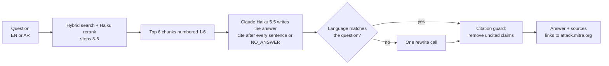

# Step 7 (phase 3): Cited answers, refusals, guards and a web page, explained

## The pipeline end to end



## Why citations after every sentence

"Every claim cites a retrieved doc" is the phase 3 gate. That is only enforceable if citations are machine-checkable,
so the format is fixed: a source number in brackets after every sentence (`[2]`, `[1][3]`). Code then checks every
answer: does each claim have a citation, does each number point to a real source, is it in the question's language.

## Why a refusal marker

An assistant that answers "What is technique T9999?" with something plausible is worse than one that says nothing.
The model must reply exactly `NO_ANSWER` when the sources don't answer the question; 12 unanswerable questions
(off-topic, fake IDs, made-up malware, future predictions, share prices) check it. All 12 were refused in every run.

## What went wrong with the prompt, and why guards exist

| Version | Change | Fully cited | Faithfulness | Language |
|---|---|---|---|---|
| v1 | first rules | 94.7% | 0.948 | 100% |
| v2 | + "answer the part the sources cover, say what they don't" | **30%** | 0.783 | 87.5% |
| v3 | drop the caveat clause, explicit Arabic rule | 97.5% | 0.932 | 100% |
| v3 on a **fresh sample** | (never tuned on) | 89.7% | 0.924 | 94.9% |
| **v3 + guards, fresh sample** | language + citation guards | **100%** | **0.960** | **100%** |

Two lessons:
1. **One sentence in a prompt can break other behaviour** (v2: the model started ending every answer with an
   uncited caveat). Every prompt change needs a full eval run.
2. **Tuning on the same questions overfits.** v3 looked fine on the questions it was tuned on and slipped on new
   ones. So the final numbers come from a fresh sample, and the rules the model must always follow are enforced
   in code (D29): a wrong-language answer gets one rewrite; uncited claims are removed.

## Faithfulness: a stronger model checks the writer

A citation can point at a source that doesn't say what the sentence claims. Claude Sonnet 5.5 reads each claim
with only the sources it cites and says yes / partial / no (D27). Faithfulness = (yes + 0.5 × partial) / claims.
In all runs there were **no "no" verdicts**; the "partial" ones are mostly extra specifics the source doesn't state
(an exact `chmod` value, an extra event ID), which the "don't add details the sources don't state" rule targets.

## Final numbers (fresh sample, 40 answerable + 12 unanswerable, `eval/results/answers_eval_validation_guarded.json`)

| Metric | Result |
|---|---|
| Answers the answerable questions | 100% |
| Refuses the unanswerable ones | 100% (12/12) |
| Answers with every claim cited | 100% |
| Invalid citation numbers | 0 |
| Answer in the question's language | 100% (guard rewrote 2 of 40) |
| Cites a primary answer page | 97.5% |
| Faithfulness (Sonnet 5.5 judge) | 0.960 (English 0.986, Arabic 0.956, mixed 0.934) |
| Time per question (CPU retrieval + API) | ~8 s |
| Cost per eval run (52 questions, writer + judge) | ~$0.30 |

## The web page

`uvicorn products.attack.api:app --port 8000`, then open http://localhost:8000. Ask in English or Arabic (the page
switches to right-to-left automatically); every `[n]` in the answer links to the attack.mitre.org page it came
from, and the source list shows which retrieved pages were actually cited.

## Things to be able to explain in an interview

- **How do you stop a RAG system from making things up?** Answer only from numbered sources, require a citation
  per sentence, refuse with a fixed marker, check it in code, and measure faithfulness with a stronger judge.
- **Why not trust the prompt?** Measured: compliance drops on new questions (97.5% -> 89.7%). Rules that must
  always hold belong in code.
- **Why a different model as judge?** A model grading its own tier tends to agree with itself; Sonnet 5.5 judging
  Haiku 5.5 is stricter, and only runs in evaluation, so it costs cents.
- **Arabic?** Retrieval works across languages (step 4); the answer is written in the question's language with
  IDs and names in Latin script, and a guard fixes the cases where the model slips.

## Run it yourself

```bash
python -m products.attack.assistant "How do I detect Kerberoasting?"     # one answer, JSON
python -m products.attack.eval_answers --seed 12                         # answer eval (~$0.30)
uvicorn products.attack.api:app --port 8000                              # web page
```
