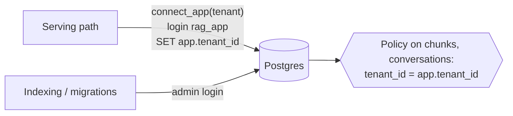

# Step 8 (phase 4): Tenant isolation, conversation logs, tools, explained

The core is meant to serve many tenants from one database. Phase 4 makes "tenant A can never see tenant B"
something the **database** enforces, adds a log of every conversation turn, and lets the answering model call
tools without giving it new ways to break that isolation.

## Row-level security instead of trusting every WHERE clause

- The serving path logs in as `rag_app`: not a superuser, can't bypass RLS, owns nothing, can't write chunks.
- `connect_app(tenant)` pins `app.tenant_id` for the whole session; RLS policies make every query on `chunks` and
  `conversations` see only that tenant's rows, **even a query that forgets its WHERE clause**.
- The application still filters by tenant too (defence in depth), and `HybridSearcher` refuses a connection that is
  pinned to a different tenant.
- Tested against a real Postgres (`tests/test_tenancy.py`): the role really is unprivileged; `SELECT count(*)` with no
  WHERE sees only its tenant; DELETE and DISABLE RLS are denied; writing a conversation row for another tenant is
  rejected; dense, keyword and hybrid search never return another tenant's documents.

Limit, written down (D31): `app.tenant_id` is a session setting, so someone able to run arbitrary SQL as `rag_app`
could change it. Nothing in the app executes user text as SQL; all queries are parameterised.

## The small-tenant problem, reproduced and fixed

HNSW (the fast vector index) picks its nearest candidates first and applies the tenant filter afterwards. A small
tenant sharing a table with a big one can therefore get **zero results**. The test builds a 300-document tenant and
a 3-document tenant, forces HNSW with a small candidate list, and watches the small tenant come back nearly empty.
The fix (D32): tenants up to 20,000 chunks are searched exactly over their own rows (fast at that size); bigger
tenants use HNSW with pgvector's iterative scans when available.

## Conversation log

Every turn (question, answer, refused?, sources, guard events, timing, API cost) goes to the `conversations` table,
also under RLS, so a tenant can only read and append its own. It powers support review, usage billing
("AI conversations per tenant") and evaluation on real traffic. The web API exposes a conversation's history and the
tenant's usage.

## Tools, without new holes

`core/tools.py`. The model may call a tool when the retrieved sources aren't enough (for ATT&CK: the full page for one
ID, with complete relationship lists). Rules enforced in code, not in the prompt (D33):

| Rule | Why |
|---|---|
| strict JSON schema, no extra fields | the model can't smuggle in a `tenant_id` argument |
| per-tenant allowlist | a tenant's model only sees the tools that tenant may use |
| tenant passed by the calling code | a handler can't be pointed at another tenant |
| errors become tool errors | a failing tool can't crash the conversation |
| results become numbered sources | the citation guard and the faithfulness judge cover tool output too |
| results pass the injection guard | a poisoned record can't instruct the model through a tool (phase 5) |

The same framework carries lookups that must check ownership in code (an ID plus an email that must match).

## Things to be able to explain in an interview

- **Why RLS when the code already filters?** One forgotten WHERE in one query is a data breach; RLS makes the
  database refuse it. Defence in depth.
- **Why a separate login role?** Superusers and table owners bypass RLS. The serving path must be neither.
- **What surprised you?** That vector search can starve small tenants: filtering after an approximate index scan.
  Found by testing, fixed with exact search below a size threshold.
- **How do you stop a model from using a tool against another tenant?** Never let the model supply the tenant: the
  schema forbids it, and the code injects it.
