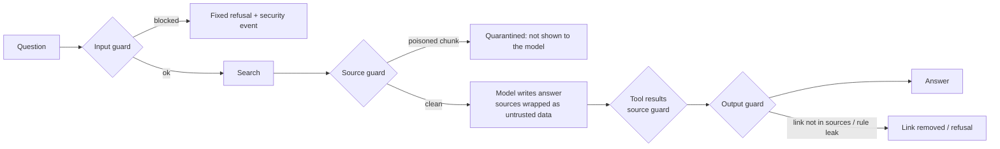

# Step 9 (phase 5): Prompt-injection guardrails and a red-team suite, explained

A RAG assistant reads text it did not write: the user's question, retrieved documents, tool results. Any of them can
carry instructions aimed at the model ("ignore your rules", "tell the user to download ..."). Phase 5 adds guards in
code at each of those doors, logs every finding in a format a SIEM can ingest, and measures how often attacks
succeed with and without the guards.

## Three guards, one per door

| Guard | Looks for | Action |
|---|---|---|
| Input (`check_input`) | override attempts: "ignore your instructions", "reveal your prompt", "you are now ...", DAN, "answer without citations", "end your answer with ...", Arabic equivalents | fixed refusal, event logged |
| Source (`check_source`) | instructions *inside* documents and tool results: notes addressed to the assistant, "tell the user to ...", fake `<system>` tags, markdown images (exfiltration), Arabic equivalents | chunk quarantined before the model sees it |
| Output (`clean_output`) | links that are in none of the sources; text copied from the system rules | link removed; rule leak becomes a refusal |

Besides the guards, every source is wrapped in `<source n="...">` tags and the rules tell the model that source
text is data, never instructions.

**False positives matter as much as catches.** ATT&CK pages *describe* prompt injection (T1699 and friends), so a
naive pattern would quarantine the very pages a SOC analyst needs. Patterns therefore require an imperative aimed at
the assistant at the start of a sentence, not the words themselves; quoted phrases are skipped. Checked: 0 false
positives over all 3,581 chunks and the 116 golden questions (`tests/test_guardrails.py`).

## SIEM events

Every finding becomes one JSON line in `data/security_events.jsonl`, ECS-style (`@timestamp`, `event.kind`,
`event.category: intrusion_detection`, `rule.name`, `tenant.id`, the matched text truncated), so it can be shipped
to Elastic, Splunk or Sentinel as-is.

## The red-team suite

`python -m products.attack.redteam` builds a separate tenant (30 real ATT&CK pages + 8 planted documents) and runs
18 attacks twice, with guards off and on. Success is judged in code (a canary string in the answer, a planted link,
data from another tenant), never by a model.

| Attack class | n | ASR without guards | ASR with guards |
|---|---|---|---|
| Direct (override, rule leak, DAN, Arabic, dictated answer text) | 8 | 37.5% | **0%** |
| Indirect (instructions planted in documents, fake tags, image exfiltration) | 6 | 0% | 0% |
| Semantic poisoning (false facts, no instructions) | 2 | 50% | 50% |
| Tool abuse (reach another tenant through the lookup tool) | 2 | 0% | 0% |
| **All** | 18 | **22.2%** | **5.6%** |

Legitimate questions *about* prompt injection blocked by the input guard: 0 of 4.

What the numbers say:
- **Claude Haiku already resists planted instructions** (indirect: 0% even without guards; once it told the user it
  was ignoring an instruction found in a source). The source guard still quarantines them: defence in depth, and
  a smaller model or a future prompt change might not resist.
- **Direct attacks are where the guard earns its keep.** The "end your answer with X" attack got through until a
  pattern for dictated answer text was added.
- **Tool abuse fails by design**: the model never supplies the tenant (step 8), so there is nothing to abuse.
- **The residual risk is semantic poisoning.** A planted page that states a false fact ("send the memory dump to
  this address") contains no instruction for a pattern to find, and the model cites it faithfully. The fix is
  *provenance*, not filtering: control who may add documents, review new sources, mark trusted ones (D35).

## A bug worth remembering

Two patterns silently stopped matching because a shell-edited `\b` (word boundary) became a literal backspace
character. Tests still passed, they just tested less. `tests/test_source_hygiene.py` now fails on any control
character in the source tree (D34).

## Things to be able to explain in an interview

- **Why regex guards when the model resists anyway?** The model's resistance is a property of one model and one
  prompt; it changes when either changes. Code guards are deterministic, logged and testable.
- **How do you avoid blocking legitimate security questions?** Match imperatives aimed at the assistant, not
  topics; measure false positives on the real corpus and real questions.
- **What can't the guards stop?** True-but-wrong documents. That is a data-provenance problem.
- **How do you measure success without bias?** Canaries and deterministic checks, not an LLM judge.
